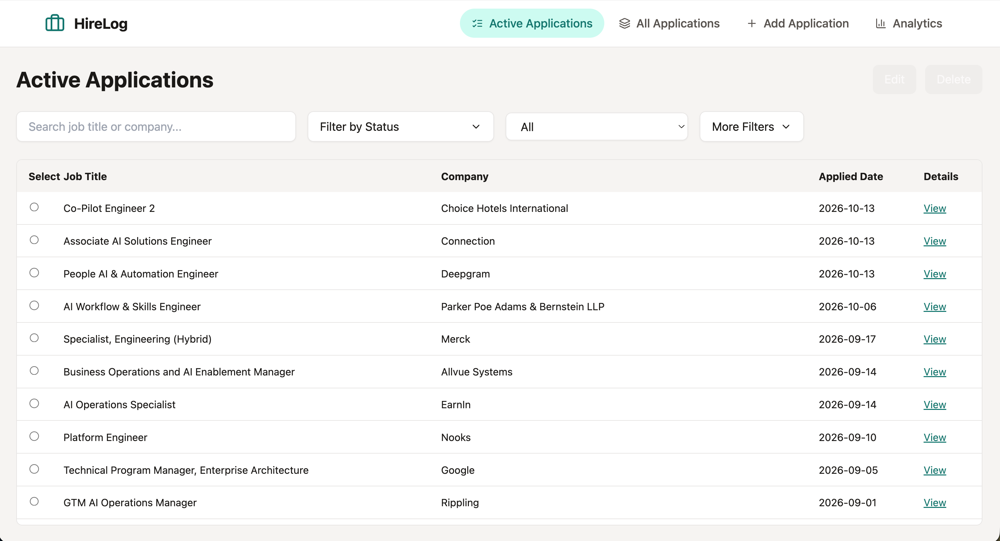
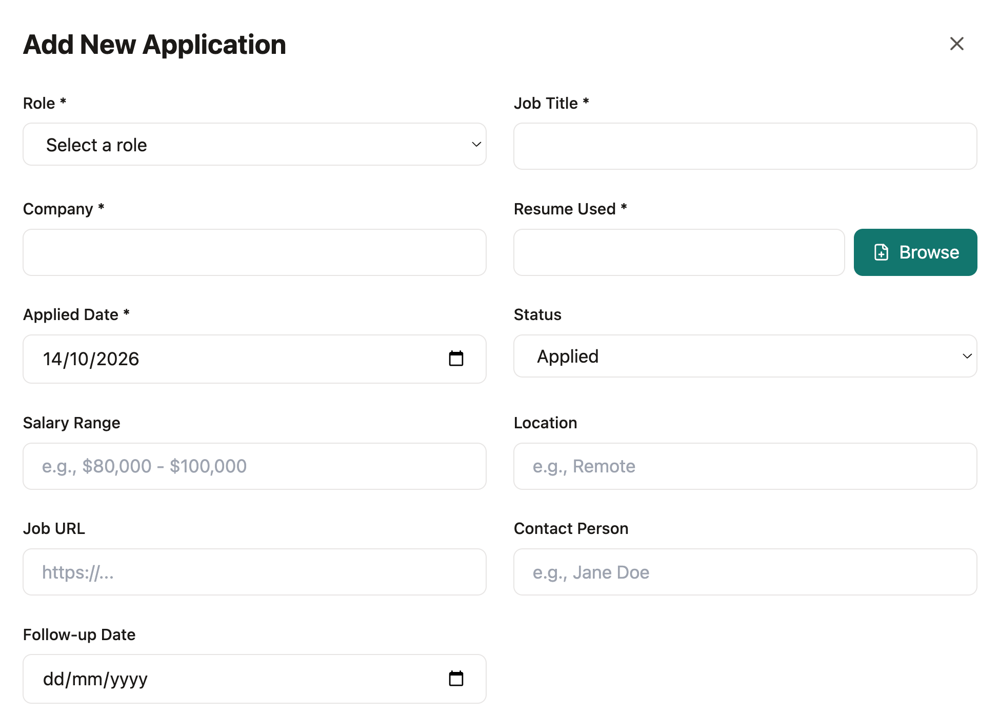
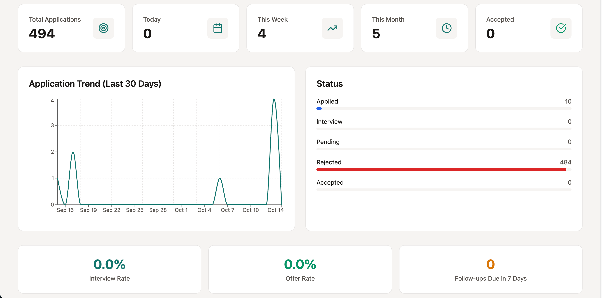

# HireLog

HireLog is a local desktop app for tracking job applications. Applications, notes, and stats stay on your machine in SQLite. There is no account and no cloud sync.


## Screenshots

| Applications | Add Application | Analytics |
| --- | --- | --- |
|  |  |  |

## Features

- Log applications with role, company, resume, status, salary, location, contact, notes, and a follow-up date
- Browse **Active Applications** (everything except rejected) and **All Applications**
- Search by job title or company, and filter by status, role, location, resume, and date
- Open a job posting in your default browser
- See the last 30 days of applications, status counts, interview rate, offer rate, and follow-ups due in the next 7 days

## Installation

HireLog is distributed for macOS.

1. [Download the latest `.dmg`](https://github.com/goutham2222/HireLog/releases/latest)
2. Open it and drag **HireLog** into Applications
3. Launch the app. No sign-in is required

If macOS blocks the app:

1. Open Terminal
2. Run:

```bash
xattr -cr /Applications/HireLog.app
```

3. Launch HireLog again

Your database is stored at:

```text
~/Library/Application Support/HireLog/applications.sqlite
```

## Usage

- **Active Applications** is the home list. Rejected applications stay on **All Applications**
- **Add Application** saves a new row and returns to the active list
- Select a row to edit or delete it. **View** opens the full record
- **More Filters** opens location, resume, and sort without moving the table
- **Analytics** shows daily, weekly, and monthly counts, a 30-day trend, and follow-ups due in the next 7 days

## Development

```bash
npm install
npm run dev
```

`npm install` rebuilds `better-sqlite3` for the Electron version in this project. `npm run dev` starts the app with Electron Forge.

| Script | What it does |
| --- | --- |
| `npm run dev` | Start the app in development |
| `npm run build` | Build the renderer, preload, and main process |
| `npm run make` | Package a macOS `.dmg` |
| `npm run clean` | Remove local build folders |

## Tech stack

- Electron Forge
- React and TypeScript
- Tailwind CSS
- better-sqlite3
- Recharts, for the 30-day trend

## Folder structure

```text
├── assets/            App icon
├── screenshots/       README images
├── scripts/           Local helper scripts
├── src/
│   ├── components/    List, form, navigation, layout
│   ├── hooks/         Shared application data
│   ├── pages/         Active, All, Add, Analytics
│   ├── types/         Application types
│   ├── utils/         Dates and stats
│   ├── App.tsx
│   ├── index.css
│   └── main.tsx
├── main.ts            Electron main process and SQLite
├── preload.ts         Bridge between the window and Electron
├── vite.main.config.ts
├── vite.preload.config.ts
└── vite.renderer.config.ts
```

## About

HireLog is a personal job-search log. The released app is macOS-only.
